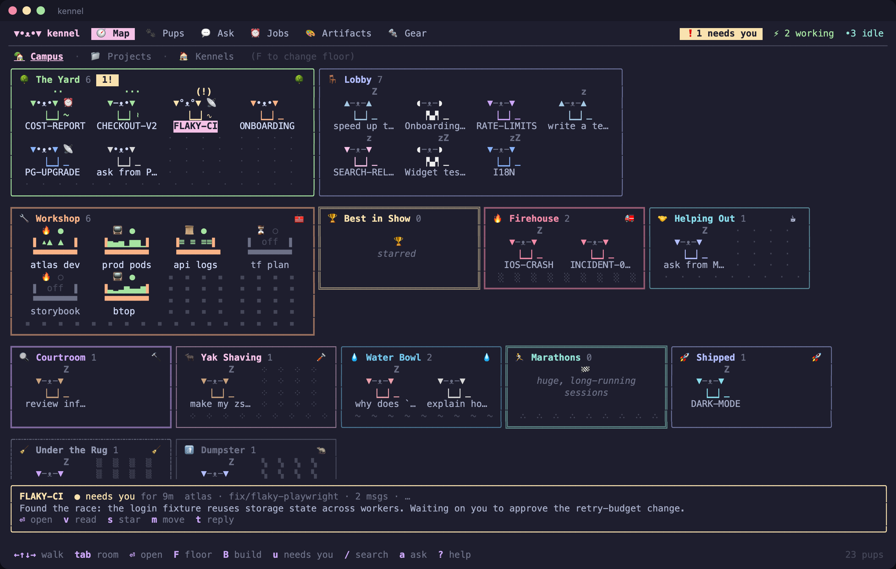
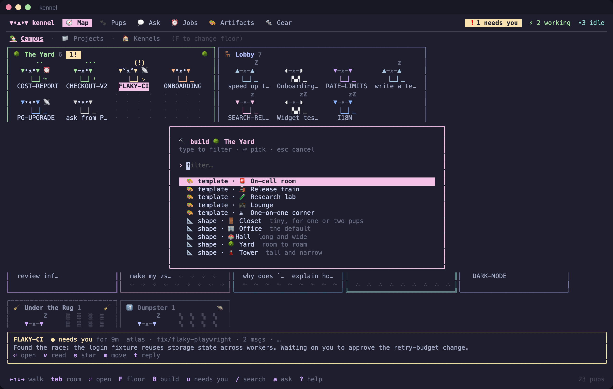
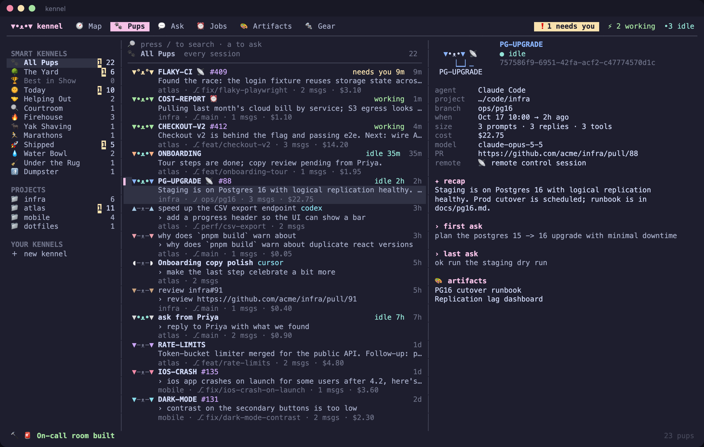
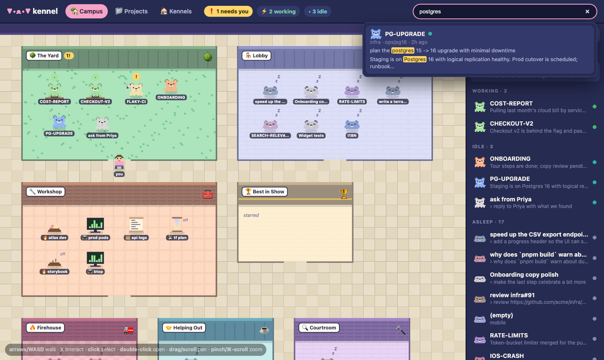
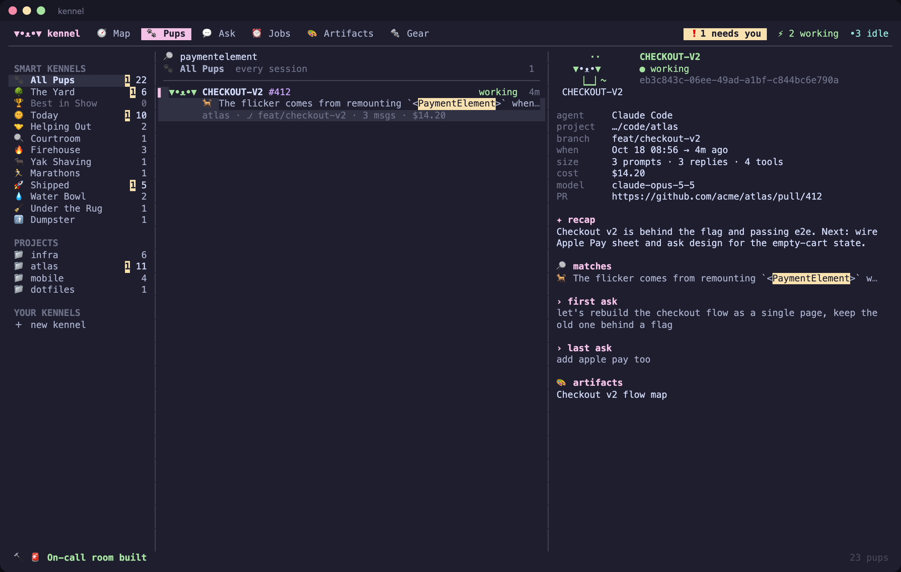
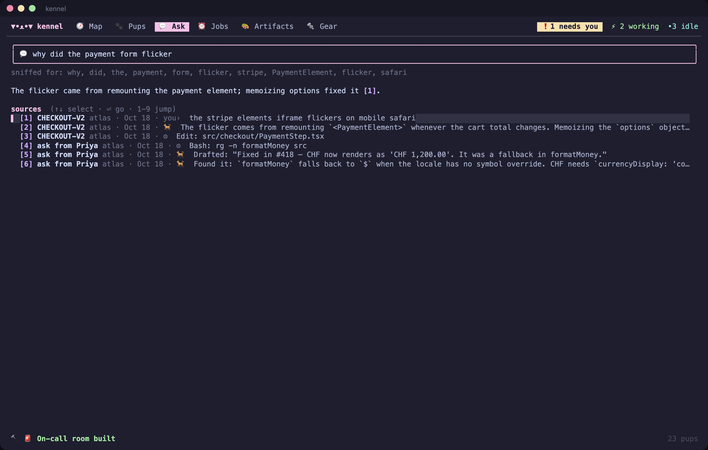
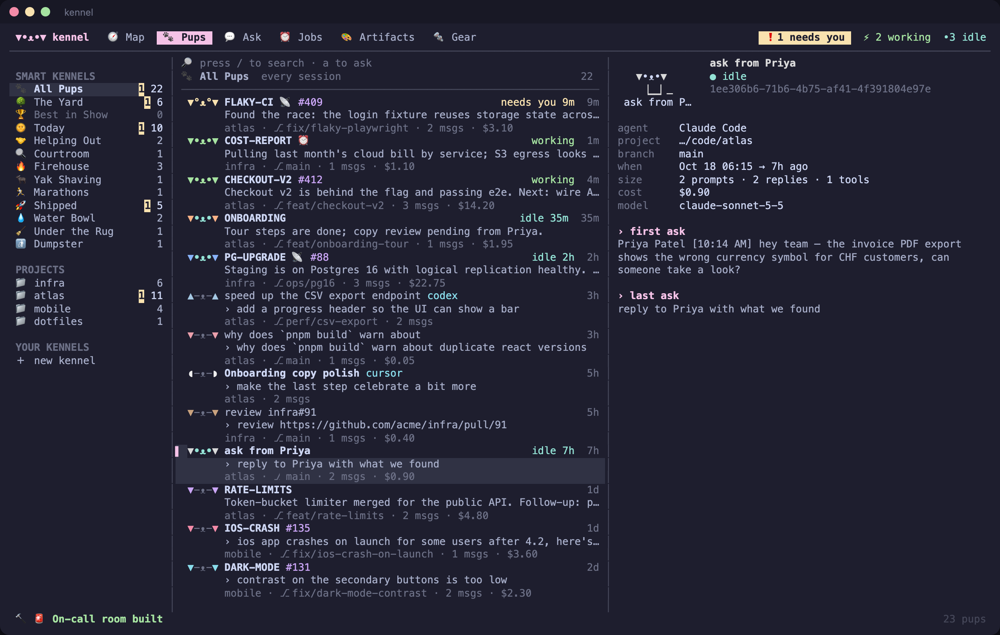
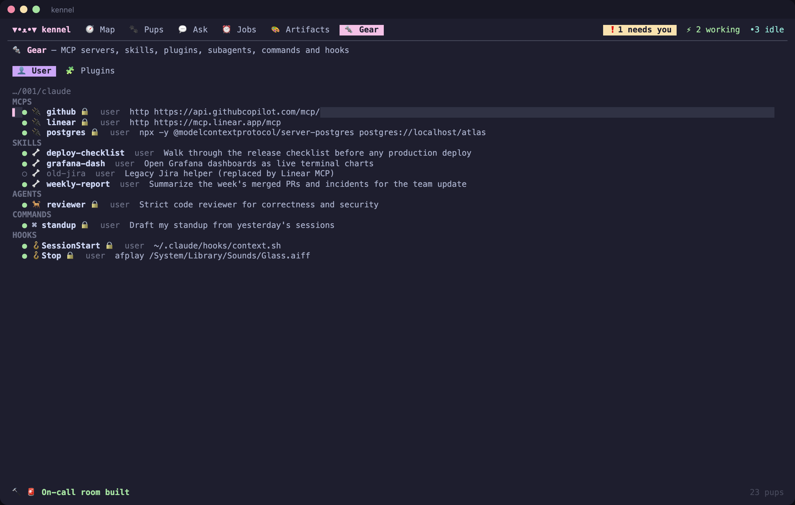
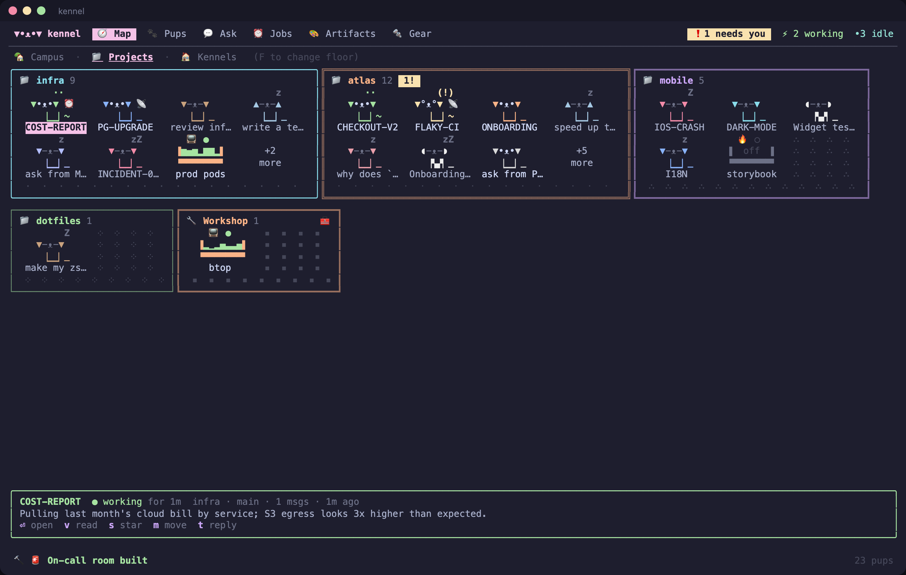
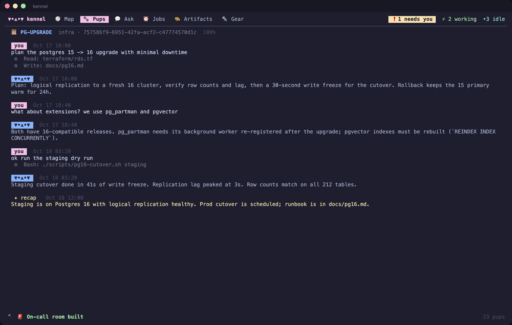

<div align="center">

# ▼•ᴥ•▼ kennel

**A cozy, Gather-style home for your Claude Code sessions.**
Find any session by name, content or meaning, see which ones need you, and jump straight into them in herdr or Ghostty.

[](https://github.com/razkevich/kennel/actions/workflows/ci.yml)
[](https://github.com/razkevich/kennel/releases)



</div>

Running ten-plus Claude Code sessions a day means losing track of them: which one needs an approval, where you fixed that flaky test last week, what the session from Priya's Slack question concluded. Kennel indexes every transcript under `~/.claude`, watches which sessions are live, and gives you two views of the same pack:

- **a terminal app** (`kennel`), fast and keyboard-first, with a map, list, search, Ask, jobs, artifacts and gear;
- **a pixel-art office in your browser** (`kennel map`), where sessions are pups that wander their rooms, sit at desks while working and bounce when they need you.

Sessions are **pups** 🐕, in three breeds: Claude Code corgis ▼•ᴥ•▼, Codex huskies ▲•ᴥ•▲ and Cursor dalmatians ◖•ᴥ•◗. Groups are **kennels** 🏠. Other terminals, such as monitors, dev servers, log tails and long jobs, are **things** 📺🔥📜⏳.

## Highlights

| | |
|---|---|
| 🧭 **Map** | Rooms of pups, Gather style: The Yard (live), Firehouse, Helping Out, Courtroom, Yak Shaving, Under the Rug… Walk with arrows, open with ⏎, change floors with `F` (campus / one room per project / your kennels). |
| 🔎 **Search** | As-you-type fuzzy matching on titles, branches, PRs and ids, plus full-text search over every prompt, reply and tool call (SQLite FTS5), with highlighted snippets. Filters: `is:live` `is:starred` `repo:x` `since:7d` `has:pr` `branch:x`. |
| 💬 **Ask (RAG)** | "What did we decide about the Postgres upgrade?" Kennel turns the question into search terms, pulls the best excerpts across sessions, and your own `claude -p` answers with numbered citations you can jump to. |
| ❗ **Needs you** | Live status from Claude Code's session registry and herdr: working / needs you / done / idle / asleep. `u` jumps to the next pup waiting on you. |
| ↗ **Open anywhere** | ⏎ focuses the live herdr pane, or resumes in a new herdr tab, a Ghostty tab (AppleScript) or right in place. Also fork (`f`), resume with remote control (`R`) and quick reply (`t`) to a running session through herdr without switching. |
| 🏠 **Organize** | Star, rename (written like `/rename`), notes, archive, recoverable trash, kennels with auto-adopt rules (`cwd=~/code/infra match=^INF-`). |
| 📺 **Things** | Non-agent terminals as objects in the rooms. Kennel finds them in herdr panes, and you can save your own commands to start, focus or stop. |
| ⏰ **Jobs** | Background agents from the Claude daemon, and cron tasks scheduled inside sessions (`/loop`, CronCreate) with their last fire time. |
| 🎨 **Artifacts** | Every artifact your sessions published, newest first, starrable, one key to open. |
| 🐺 **Claude, Codex, Cursor** | Indexes Claude Code transcripts, Codex CLI rollouts (`~/.codex/sessions`) and Cursor's agent chats (read-only from its state database). Each opens in its own tool: `claude --resume`, `codex resume`, or Cursor on the folder. Filter with `agent:codex`. |
| ↔ **Convert** | Continue any session in another agent (`c`): kennel exports the conversation to Markdown and starts Claude or Codex with a handoff brief, or opens Cursor on the folder with the handoff document. |
| ⑂ **Fork · clone · merge** | Fork (`f`) a Claude session, clone it into another project (`C`), merge several sessions into a new pup seeded with a combined brief (`M`), or distill a huge one into a fresh start (`Z`). Export any conversation as Markdown (`E`). |
| 📰 **Digest** | `d` or `kennel digest`: what you touched, shipped and spent, what's waiting, and what slid under the rug. |
| 🔨 **Build** | Shape any room: templates (on-call room, release train, research lab, lounge, one-on-one corner), size and shape, floor, walls and furniture. Add **purpose blocks**: 🚪 spawn door (new pup with a preset folder, name, prompt and model), 🧲 magnet (auto-adopt), 🔔 bell (desktop alert), 🌀 portal (open in a herdr workspace), 📌 pin board, 🧹 archive chute. In the browser: drag and drop. In the TUI: `B`. |
| 🔩 **Gear** | MCP servers, skills, plugins, subagents, commands and hooks at user, project and plugin level. Toggle skills, plugins and project MCP servers safely. |

## Screens

<table>
<tr><td></td><td></td></tr>
<tr><td align="center"><code>kennel map</code>: the office</td><td align="center">click a pup for its card</td></tr>
<tr><td></td><td></td></tr>
<tr><td align="center">build mode: templates, floors, walls, furniture, blocks</td><td align="center">the same blocks from the TUI (<code>B</code>)</td></tr>
<tr><td></td><td></td></tr>
<tr><td align="center">one room per project: corgis, huskies and dalmatians</td><td align="center">the list, with live status and previews</td></tr>
<tr><td></td><td></td></tr>
<tr><td align="center">Ask with citations</td><td align="center">search across transcripts</td></tr>
<tr><td></td><td></td></tr>
<tr><td align="center">TUI: content search with matches</td><td align="center">TUI: Ask</td></tr>
<tr><td></td><td></td></tr>
<tr><td align="center">Jobs & things</td><td align="center">Gear: MCP, skills, plugins, hooks</td></tr>
<tr><td></td><td></td></tr>
<tr><td align="center">Projects floor: one room per repo</td><td align="center">read any transcript, find inside it</td></tr>
</table>

Every screenshot is generated from built-in synthetic sessions (`kennel -demo`), not real ones.

## Install

```sh
# Homebrew-less: grab a binary from Releases, or
go install github.com/razkevich/kennel/cmd/kennel@latest
```

Single static binary, no CGO. macOS and Linux, amd64 and arm64. Ask needs the `claude` CLI on your PATH (it already is, if you use Claude Code).

## Use

```sh
kennel                      # the TUI
kennel map                  # the Gather-style office in your browser
kennel search "flaky login" # names + transcripts, scriptable (-json)
kennel ask "why did checkout flicker on safari?"
kennel open KALSHI          # resume by name or id prefix (-fork, -remote, -opener ghostty)
kennel convert KALSHI -to codex     # continue in another agent
kennel merge KALSHI C1VEGA -name RELOC   # one new pup with both histories' brief
kennel clone KALSHI -to ~/code/other     # copy a session into another project
kennel export KALSHI -o kalshi.md   # Markdown transcript
kennel digest -since 168h           # the week in pups
kennel -demo                # try it on synthetic sessions
```

### Keys (TUI)

| key | does |
|---|---|
| `1`–`6`, `[` `]` | tabs: Map, Pups, Ask, Jobs, Artifacts, Gear |
| `/` · `a` · `ctrl+k` | search · ask · jump anywhere |
| `⏎` · `f` · `R` · `t` | open/focus · fork · remote control · quick reply |
| `C` · `M` · `Z` · `c` · `E` | clone · merge · distill · convert to another agent · export Markdown |
| `T` · `d` | suggest a name (via claude) · digest |
| `v` / `space` | read transcript (`/` to find, `n`/`N`) |
| `s` `r` `m` `N` `x` `D` | star, rename, move to kennel, note, archive, trash |
| `K` · `e` on a kennel | new kennel · edit name and rules |
| `u` | next pup that needs you |
| `B` | build the current room: template, shape, floor, walls, blocks |
| `F` (map) · `N` (map/jobs) | change floor · new thing |
| `y` `Y` `p` `A` | copy id, copy resume command, open PR, open artifact |
| `?` | help |

### Smart kennels

Built in, derived from how people actually use Claude Code:

| | room | who lives there |
|---|---|---|
| 🌳 | **The Yard** | everything running right now |
| 🏆 | **Best in Show** | starred |
| 🔥 | **Firehouse** | incidents, prod, alerts, crashes |
| 🤝 | **Helping Out** | sessions started from a colleague's Slack message |
| 🔍 | **Courtroom** | PR reviews |
| 🐃 | **Yak Shaving** | tools, setup and dotfiles tinkering |
| 💧 | **Water Bowl** | quick questions |
| 🏃 | **Marathons** | huge, long-running sessions |
| 🚀 | **Shipped** | opened a PR |
| 🧹 | **Under the Rug** | real work, abandoned more than a week ago, no PR |
| 🚮 | **Dumpster** | empty or archived |

## How it works

- **Index.** Transcripts in `~/.claude/projects/*/*.jsonl` are append-only, so kennel remembers a byte offset per file and parses only new lines. The first run indexes in the background while the UI is already usable. On a 1.4 GB synthetic history: about 40s cold, 5 ms re-sync, about 160 ms for a full-text query.
- **Live status** comes from `~/.claude/sessions/<pid>.json`, which Claude Code maintains, plus `herdr agent list` for blocked/done state and pane ids. No hooks to install.
- **Ask** shells out to your `claude -p` with `--no-session-persistence`, no tools and no MCP servers. Nothing is sent anywhere else, and Ask never creates sessions of its own.
- **Never destructive.** Rename appends the same record `/rename` writes, and only when the session isn't running. Trash moves a transcript to `~/.kennel/trash`. Archive is kennel-only metadata.
- **The web map** listens on `127.0.0.1` only. It requires a per-run token and rejects non-loopback `Host` headers.

Data lives in `~/.kennel/kennel.db`. Override paths with `KENNEL_CLAUDE_DIR` and `KENNEL_HOME`, and the opener with `KENNEL_OPENER=auto|herdr|ghostty|inline|print`.

## Develop

```sh
go test -race ./...                       # unit tests + TUI tests (keys, clicks, rendering)
cd e2e && npm ci && npx playwright test   # browser tests: click pups, search, ask, things
```

Every test runs against synthetic sessions with a recorder standing in for herdr, osascript and the browser opener. Nothing touches your real sessions or terminals.

Refresh the README screenshots:

```sh
KENNEL_SHOTS=/tmp/ans go test ./internal/tui -run TestShots && (cd e2e && node tui-shots.mjs /tmp/ans ../docs/img)
(cd e2e && SHOTS=1 npx playwright test screenshots)
```

## Roadmap: ideas we're chewing on

**More building blocks**
- ⏲ **timer**: a recurring prompt for a room's pups ("every morning, summarize overnight alerts").
- 📺 **screen**: pin a thing's live output (the last lines of a log tail) onto a wall.
- 🧭 **signpost**: link rooms across floors; 🚦 **gate**: hold new pups for approval before they start.
- 🏷 **label maker**: tag pups by the people, tickets or services they mention.
- Shareable room templates (export or import JSON), multi-room "office kits", and furniture that does things (a coffee machine that pings the idle pups).

**More cool stuff**
- Semantic vectors through a local Ollama model, alongside BM25.
- People view: who you helped this week (from Slack-paste sessions).
- Session lineage: forks, clones, merges and `continued-in` chains drawn as leashes between pups.
- More agents: Gemini CLI, Aider, opencode, and Cursor's CLI chats.
- Cost and time per kennel, per week.
- Worktree janitor: stale worktrees whose pups are asleep.
- Remote machines: herdr `--machine` pups on other hosts in an "Annex".
- Shareable read-only snapshot of a room for teammates.

## License

MIT
