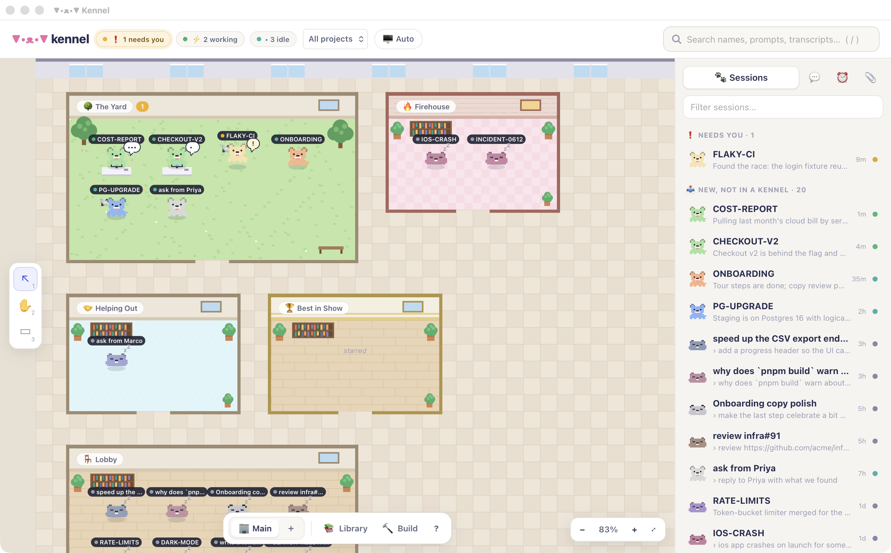
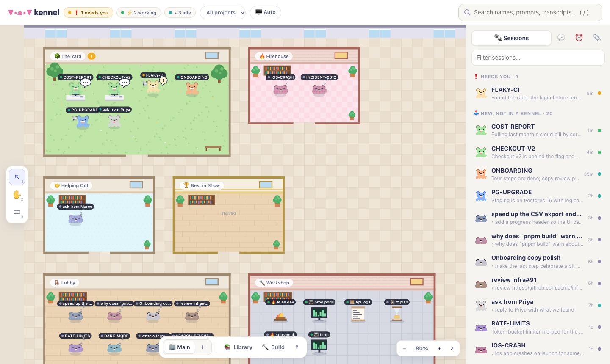
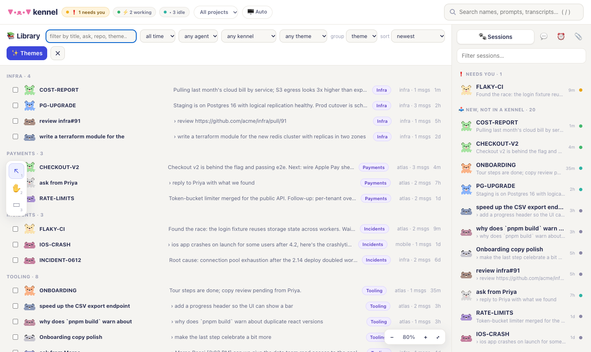
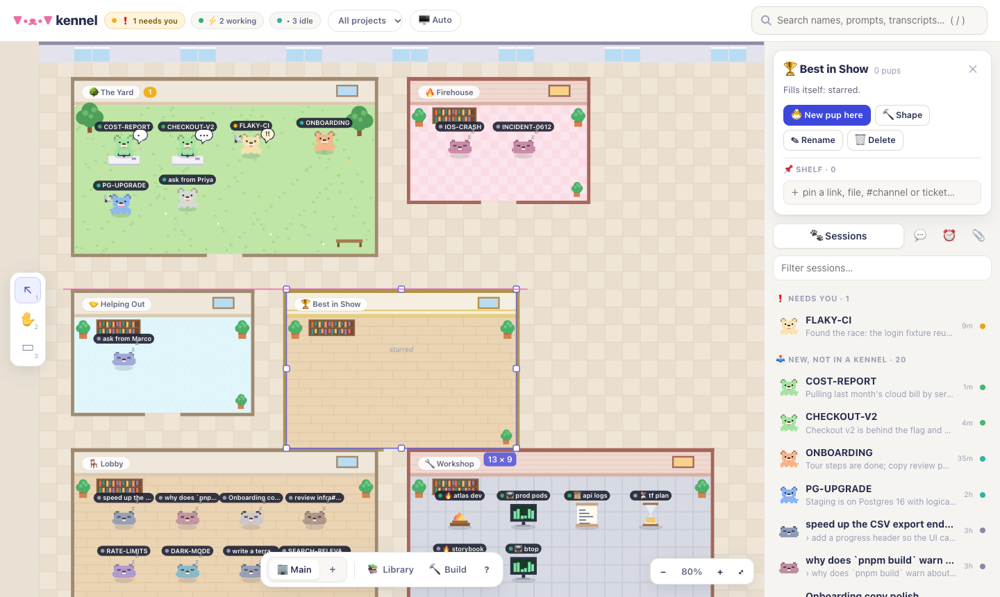
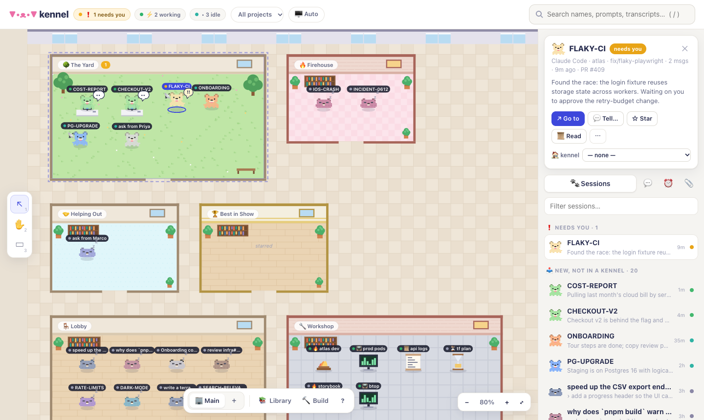
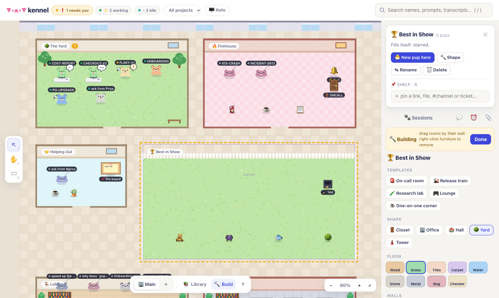
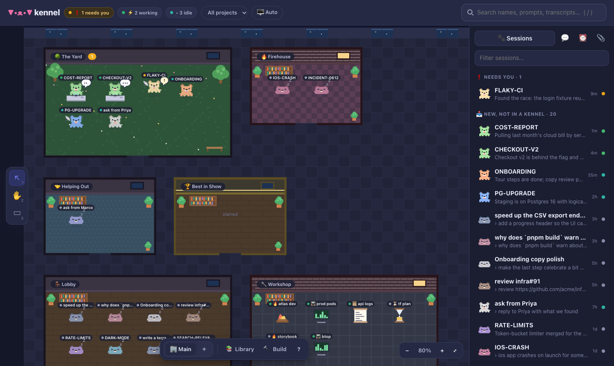
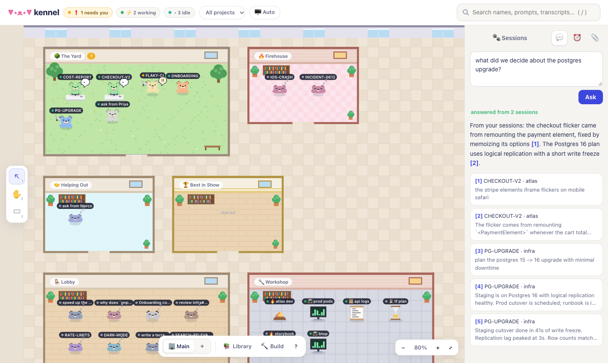
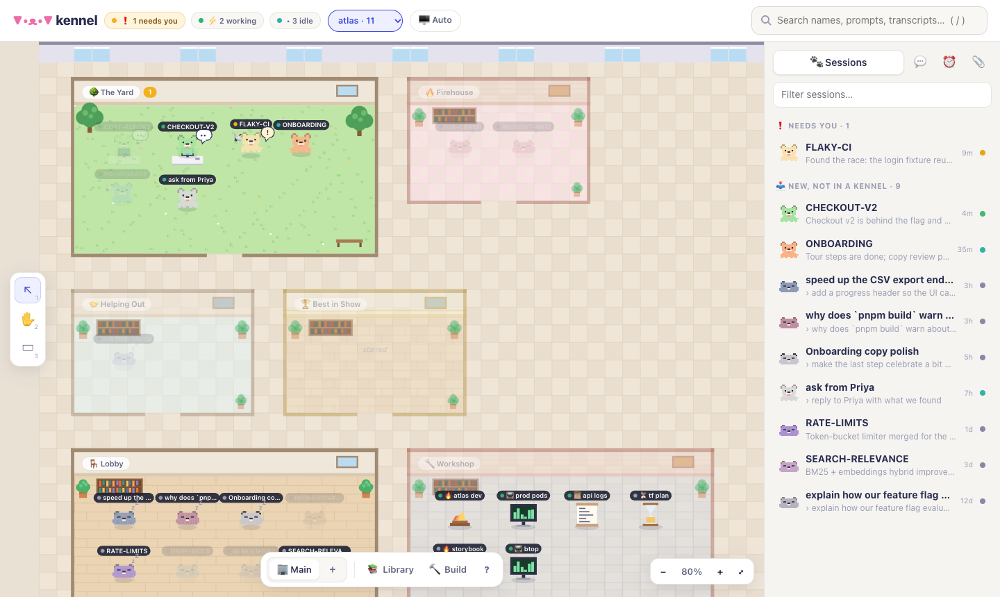
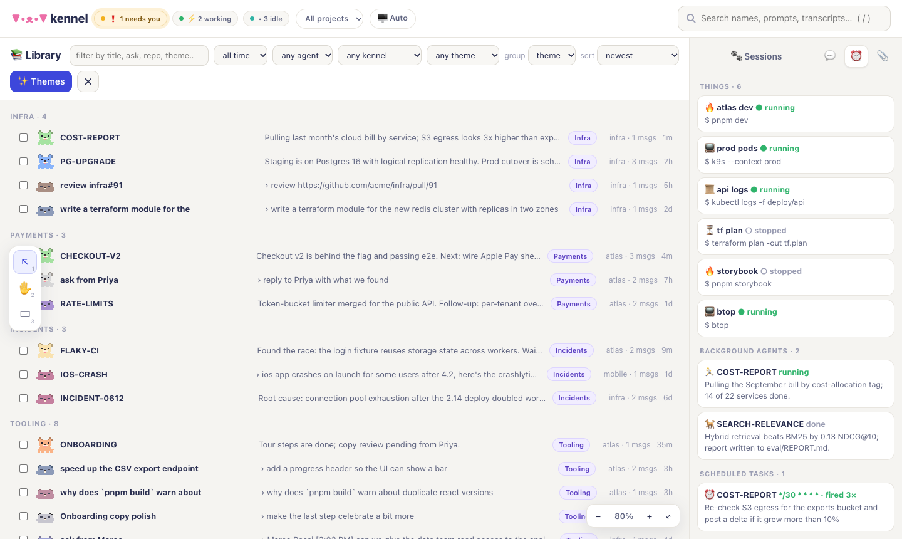

<div align="center">

# ▼•ᴥ•▼ kennel

**A cozy, Gather-style home for your Claude Code, Codex and Cursor sessions.**
Find any session by name, content or meaning, file them into rooms, see who needs you, and open them as terminal tabs.

[](https://github.com/razkevich/kennel/actions/workflows/ci.yml)
[](https://github.com/razkevich/kennel/releases)



</div>

Running ten-plus agent sessions a day means losing track of them: which one needs an approval, where you fixed that flaky test last week, what came of a colleague's Slack question. Kennel indexes every transcript, watches which sessions are live, and puts them in a pixel-art office.

- **Kennel for Mac** has a pinned 🐾 Kennel tab holding the office. Every session you open becomes a normal terminal tab next to it, rendered with your Ghostty font and colors, and a menu-bar pup shows who needs you.
- **The same app in your browser:** `kennel` serves the identical UI, and sessions open in herdr or Ghostty instead.

Sessions are **pups**: Claude Code corgis ▼•ᴥ•▼, Codex huskies ▲•ᴥ•▲ and Cursor dalmatians ◖•ᴥ•◗. Rooms are **kennels**. Other terminals, such as monitors, dev servers, log tails and long jobs, are **things** 📺🔥📜⏳.

## What's in it

| | |
|---|---|
| 🗺 **The office** | One map, with as many **floors** as you like (＋ in the dock; right-click a floor tab to rename or remove it; drag a kennel onto a tab to move it). Each floor holds **your kennels**, which show what you filed, and optional **smart rooms** that fill themselves: Live now, Firehouse, Helping Out, Best in Show, Lobby, Workshop and more, added from 🔨 Build. Pups wander, sit at desks while working, and bounce with `!` when they need you. Click to inspect, double-click to open. |
| ✋ **Arrange it by hand** | Drag pups anywhere in their room, or onto another kennel to file them. Marquee-select several and move them together. Select a room to get handles: drag its wall to move it and its handles to resize it, with snap guides as you go. Draw a new kennel with the ▭ tool. Right-click anything for its actions. Take pups out of a kennel by dragging them out, with Delete, or from the right-click menu or their card. That only unfiles them: the session goes back to 📥 New in the tray, and rule-based kennels won't pull it back. Tools: `V` select, `H` hand (or hold Space), `R` kennel. |
| 🌗 **Light and dark** | A day office and a night office. The 🖥 Auto / ☀️ Light / 🌙 Dark switch in the top bar (or `Shift+T`, or View → Appearance in the Mac app) is shared by every open window. |
| 🐾 **Session tray** | The side panel lists the last two weeks: ❗ needs you, 📥 new (not in a kennel), ⚡ working, 🕘 recent. Filter it, and drag any row onto a kennel to file it. |
| 📁 **Project filter** | Pick a project at the top: the tray narrows to it and the rest of the map fades. |
| 📚 **Library** | Every past session: filter by date, agent, kennel or theme, group by day, week, theme, kennel, repo or agent, sort, and move many at once. |
| ✨ **Themes** | Automatic categories from an LLM, Cloudflare Workers AI or your `claude` haiku. Only titles, first asks and recaps are sent. |
| 🔎 **Search** | Fuzzy titles, branches and PRs, plus full-text over every prompt, reply and tool call, with highlighted snippets. Filters: `is:live` `repo:x` `agent:codex` `since:7d` `has:pr`. |
| 💬 **Ask** | "What did we decide about the Postgres upgrade?" Answered from your sessions with numbered citations you can jump to. |
| ❗ **Live status** | Working, needs you, done, idle or asleep, from Claude Code's session registry and herdr. No hooks to install. |
| 🗂 **Organize** | Star, rename (written like `/rename`), notes, archive, recoverable trash, rooms with auto-adopt magnets. **Undo** everything with ⌘Z. |
| ⑂ **Fork, clone, merge, convert** | Fork; clone into another project; merge several sessions into a new pup from a brief; distill a long one; continue any session in another agent (Claude ↔ Codex ↔ Cursor) through a Markdown handoff. The original is never touched. |
| 📌 **Shelves** | Keep files, links, `#slack-channels`, tickets and your sessions' artifacts on a kennel: they sit on its back wall and its card, open in one click, and have a ⋯ menu to move or remove them. The 📎 panel lists everything, including artifacts from sessions (pin or hide them). Drag any item onto a kennel to pin it, or onto a pup to feed it: a live pup gets it as a prompt, an asleep one wakes up with it. |
| 💬 **Quick tell** | Select a pup and press `t` (or right-click → Tell): type one line and stay on the map. It's typed into the pup's herdr pane or Kennel tab, or an asleep Claude session works on it in the background. |
| 🔨 **Build** | Room templates, shapes, floors, walls and furniture, plus purpose blocks: 🚪 spawn door, 🧲 magnet, 🔔 bell, 🌀 portal to a herdr workspace, 📌 pin board, 🧹 archive chute. |
| ⏰ **Jobs** | Background agents, in-session cron tasks, monitors and servers. |

## Screens

<table>
<tr><td></td><td></td></tr>
<tr><td align="center">the office, with the session tray</td><td align="center">📚 library, grouped by ✨ theme</td></tr>
<tr><td></td><td></td></tr>
<tr><td align="center">✋ select a room, drag handles to resize</td><td align="center">a pup's card: state and every action</td></tr>
<tr><td></td><td></td></tr>
<tr><td align="center">🔨 build mode</td><td align="center">🌙 the night office</td></tr>
<tr><td></td><td></td></tr>
<tr><td align="center">💬 Ask, with citations</td><td align="center">📁 one project in focus</td></tr>
<tr><td colspan="2"></td></tr>
<tr><td colspan="2" align="center">⏰ jobs and things</td></tr>
</table>

Every screenshot comes from built-in synthetic sessions (`kennel -demo`), not real ones.

## Install

**Mac app:** download `Kennel.app.zip` from [Releases](https://github.com/razkevich/kennel/releases), unzip it into Applications, and open it. The first time, right-click and choose Open, because the app is ad-hoc signed.

**Browser only:**
```sh
go install github.com/razkevich/kennel/cmd/kennel@latest   # or grab a binary from Releases
kennel                                                    # opens the office in your browser
```

## Use

```sh
kennel                              # the office (in your browser)
kennel search "flaky login"         # names + transcripts (-json)
kennel ask "why did checkout flicker on safari?"
kennel open KALSHI                  # resume by name or id (-fork, -remote, -opener herdr|ghostty|inline)
kennel convert KALSHI -to codex     # continue in another agent
kennel merge KALSHI C1VEGA -name RELOC
kennel clone KALSHI -to ~/code/other
kennel export KALSHI -o kalshi.md
kennel -demo                        # try it on synthetic sessions
```

**Keys in the office:** `/` search · `V` `H` `R` tools · Space-drag pan · `+` `-` `Shift+1` zoom · `Delete` remove from kennel (archive elsewhere) · `Shift+T` light/dark · `t` tell · `Enter` open · arrows pan · `l` library · `b` build · `⌘Z` undo · `Esc` close.
**Keys in the Mac app** follow Ghostty's defaults:

| | |
|---|---|
| Tabs | `⌘T` new (in the current directory) · `⌘⌥W` close tab · `⌘1–9` by position (`⌘1` is Kennel) · `⌘⇧[ ]` previous/next · `⌘⇧K` Kennel |
| Splits | `⌘D` split right · `⌘⇧D` split down · `⌘W` close split · `⌘[ ]` previous/next split · `⌘⌥←↑↓→` move between splits · `⌘⌃←↑↓→` resize · `⌘⌃=` equalize · `⌘⇧↩` zoom a split. Drag a divider to resize. Unfocused splits dim (`unfocused-split-opacity`). |
| Terminal | `⌘K` clear · `⌘F` find, `⌘G` / `⌘⇧G` next/previous, `⌘E` use selection · `⌘=` `⌘-` `⌘0` font size per tab (page zoom in the Kennel tab) · `⌘↩` full screen |
| Config | `⌘,` opens your Ghostty config · `⌘⇧,` reloads it: font, colors, palette, `split-divider-color`, `unfocused-split-opacity` |

**Themes with Cloudflare:** put `CLOUDFLARE_AI_TOKEN` and `CLOUDFLARE_ACCOUNT_ID` in the environment or in `~/cloudflare_ai_token.env`. Optionally set `KENNEL_CF_MODEL` (default `@cf/meta/llama-3.1-8b-instruct-fast`). Without them, kennel uses `claude` haiku.

## How it works

- **Index.** Claude Code transcripts (`~/.claude/projects`), Codex rollouts (`~/.codex/sessions`) and Cursor composer chats, read-only from its state database, go into SQLite with FTS5. Kennel parses only the bytes appended since the last pass, and the first index runs in the background.
- **Live status** comes from `~/.claude/sessions/<pid>.json` and `herdr agent list`.
- **Opening.** In the Mac app, the page hands launches to the app over a WebKit message bridge and they become tabs. In a browser, kennel focuses the herdr pane or opens herdr or Ghostty tabs.
- **Safety.** Everything kennel sends to a shell or terminal has control bytes removed. Only Claude transcripts are ever written to, and only by rename (the same record `/rename` writes). Trash moves files and never deletes them. The page listens on `127.0.0.1` with a per-run token and a Host check.

Kennel's own data lives in `~/.kennel`. Override paths with `KENNEL_CLAUDE_DIR`, `KENNEL_CODEX_DIR`, `KENNEL_CURSOR_DIR` and `KENNEL_HOME`.

## Develop

```sh
go test -race ./...                         # core, store, indexer, search, agents, blocks, undo
(cd e2e && npm ci && npx playwright test)   # browser UI: clicks, drags, build mode, library, panels
(cd macos && ./test.sh)                     # Swift unit tests
(cd macos && swift build) && node --test e2e/app/app.test.mjs   # Mac app UI: tabs, shortcuts, terminals, clicks, dialogs
macos/build-app.sh                          # dist/Kennel.app
```

The Mac app UI tests launch the real app on synthetic sessions with fake runs, so no real agent is started. They drive it through an automation port that is enabled only by `KENNEL_APP_AUTOMATION`: real menu shortcuts, real clicks in the page, typing into terminals, and reading terminal text. Every test uses synthetic data, with recorders standing in for herdr, osascript and the browser.

## Roadmap

- More blocks: ⏲ timer (a recurring prompt per room), 📺 screen (a thing's live output on a wall), 🚦 gate, 🏷 label maker; shareable room templates.
- Semantic vectors (local Ollama) alongside BM25; lineage leashes between forks, clones and merges.
- More agents: Gemini CLI, Aider, opencode, Cursor's CLI chats; remote herdr machines in an "Annex".

## License

MIT
